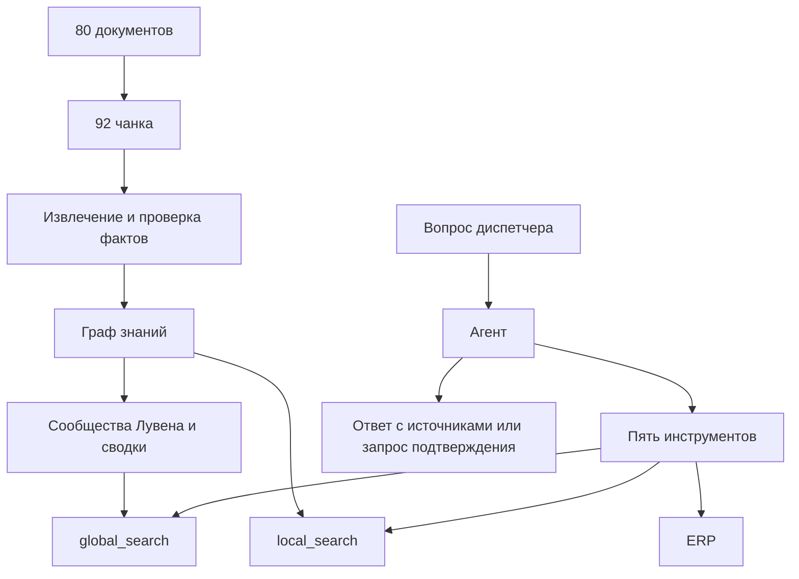

# Ассистент сервисной службы на Graph RAG
Итоговый проект по курсу «ИИ-мышление: наука и технологии».

Автор — Илиев Илия Ивелинович.


Ассистент помогает диспетчеру подобрать деталь холодильного оборудования по модели и коду ошибки,
найти актуальную замену, проверить цену и остаток в учебной ERP и подготовить заказ
для подтверждения человеком. Ответы сопровождаются документами-источниками и шагами вызова инструментов.

Проект разработан на основе учебного репозитория ИТМО. Исходная платформа включает корпус документов,
ERP, плоский RAG, клиент модели, оценщик и тесты. В ходе работы реализованы шесть модулей
извлечения знаний, поиска и агента.
[Исходное задание](https://github.com/itmo-digital-culture/llm-project).

## Состояние проекта

Реализованы требования FR-1 — FR-10. На итоговом прогоне прошли 142 теста, включая 50 контрактных,
а Ruff завершил проверку сообщением `All checks passed!`.
Последовательность сборки, индексации, тестирования и оценки воспроизведена на свежем клоне с GitHub
с сохранённым кешем модели. Все восемь итоговых JSON совпали с рабочей копией.

Результаты и кеш находятся в `artifacts/`. Подготовка отчёта `REPORT.pdf` и метки сдаваемой версии
`v1.0` остаётся завершающим этапом.

## Задача

«ПолярТех» — вымышленная компания по обслуживанию холодильного оборудования трёх линеек —
«Арктика», «Бриз» и «Гольфстрим». В руководствах описаны модели, узлы и ошибки,
в бюллетенях — замены деталей, в регламентах — порядок ремонта, в отчётах о выездах — подтверждённые отказы.
Цены, складские остатки и заказы хранятся в ERP.

Для вопроса «Какую деталь заказать при ошибке E-17 на AR-210?» требуется связать сведения из нескольких документов.
В модели установлено пусковое реле `P-1042`, а бюллетень сообщает о его замене на `P-1042B`.
На контрольном прогоне режим `local` назвал `P-1042B` и указал `bulletin_SB-2025-03.md` в источниках.
Агент дополнительно получил из ERP остаток 3 штуки в Казани и цену 2630 рублей.

## Как устроено решение

При индексации 80 документов разбиваются на 92 чанка. Модель извлекает сущности и связи
в формате JSON по заданной схеме. Python проверяет типы, нормализует коды и фильтрует неподтверждённые данные.
Разбор явных полей состава узлов и отчётов о выездах дополняет извлечение структурированных фактов.
Из результатов собирается направленный граф NetworkX с источниками и весами рёбер.
Алгоритм Лувена выделяет сообщества, для которых модель составляет сводки.
Числа для сводок вычисляются кодом по весам рёбер.



| Режим | Как получается ответ |
| --- | --- |
| `baseline` | Поиск близких чанков по эмбеддингам и генерация по найденному контексту |
| `local` | Поиск опорных сущностей, путей и цепочек замен в графе, генерация по пронумерованным фактам |
| `global` | Частичные ответы по сводкам сообществ и их объединение в два шага map/reduce |
| `agent` | Выбор и вызов инструментов поиска и ERP в диалоге с моделью |

Агент использует инструменты `search_knowledge`, `summarize_topic`, `check_stock`, `get_price`
и `create_service_order`. Предусмотрены проверка аргументов и известных номеров деталей,
лимит вызовов, переиспользование результатов одинаковых запросов и два повтора при недоступности ERP.
Создание заказа требует количества из вопроса и `confirm=True`.
При `confirm=False` агент возвращает `needs_confirmation=True` и `pending_action`.

## Стек

Python 3.11 в Docker, Ollama, `qwen3:4b-instruct-2507-q4_K_M`, эмбеддинги `bge-m3`,
NetworkX, FastAPI, Docker Compose, uv, pytest и Ruff.
Зависимости зафиксированы в `pyproject.toml` и `uv.lock`.

## Запуск

Проверенный вариант использует Docker Desktop и Ollama на macOS с Apple Silicon.
Для запуска нужны Git, make, Docker с Compose и работающая Ollama.
Загрузите обе модели и клонируйте репозиторий.

```bash
ollama pull qwen3:4b-instruct-2507-q4_K_M
ollama pull bge-m3

git clone https://github.com/iLiaxxxiLiev/llm-project.git
cd llm-project
cp .env.example .env
make up
make index